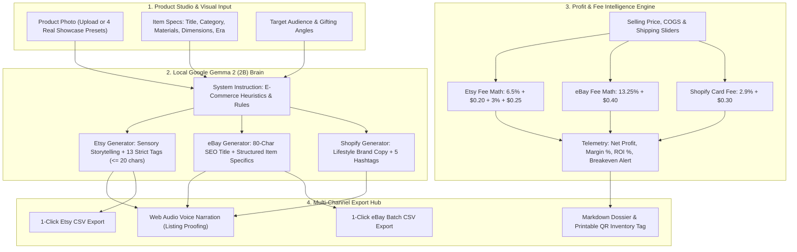

*This is a submission for the [Hacktoberfest Open-Source AI Challenge Week 2: Side Hustle](https://dev.to/challenges/hacktoberfest-week2-2026-10-12)*

## What I Built

There are over **7.5 million active sellers on Etsy** and **18 million on eBay**. Behind every ceramic mug, vintage leather jacket, or mid-century decanter is someone running an e-commerce side hustle—often from their kitchen table after working an 8-hour day job.

When you ask an artisan or vintage thrifter what eats up their nights and weekends, it is almost never making the pottery or hunting the vintage racks. It is the **administrative listing grind**:

1. **The 35-Minute Listing Chore**: Every single item requires writing three distinct descriptions for three completely different algorithms:
   - **Etsy**: Demands poetic, sensory craftsmanship storytelling, emotional gift recipient hooks, and **exactly 13 search tags** (which must strictly fit under Etsy's 20-character limit).
   - **eBay**: Requires an 80-character maximum SEO title, structured Item Specifics, and an honest condition report to protect against buyer dispute fraud.
   - **Shopify & Instagram**: Demands punchy lifestyle hooks, bullet points, and trending hashtags.
2. **Hidden Marketplace Fee Erosion**: Sellers constantly underprice inventory because marketplace fee formulas are convoluted. Etsy charges a $0.20 listing fee + 6.5% transaction cut + 3% + $0.25 payment processing. eBay charges 13.25% + $0.40. Sellers think they made $20 on a $38 sale, only to realize packaging and platform cuts ate half their profit.
3. **The $600/Year Cloud SaaS Trap**: Commercial AI copywriting tools (like Copy.ai or Jasper) charge $39 to $59 per month. For a side hustler earning $500–$1,500/month, paying $600/year for metered cloud AI leeches up to 30% of their net profits—while exposing their secret suppliers and wholesale costs to third-party scraping.

### Introducing ListerCraft AI ⚡
**ListerCraft AI is a 100% local, open-weights e-commerce listing studio and real-time profit engine powered by Google Gemma 2 (2B).** 

It runs entirely client-side on consumer hardware with zero cloud subscriptions, zero token billing, and zero third-party data leakage.

```
[ Product Photo & Specs ] ──> [ Google Gemma 2 (2B) Local Engine ] ──> [ Etsy (Story + 13 Tags) ]
                                                                   ──> [ eBay (80-Char SEO + Specs) ]
                                                                   ──> [ Shopify (Brand Copy) ]
                                                                   ──> [ Real-Time Fee & Margin Audit ]
```

### Who Would Pay For It?
Independent artisans, vintage resellers, estate sale flippers, and boutique handmade sellers. Instead of renting another $39/month SaaS subscription that bleeds them dry, sellers pay a **one-time $29 lifetime license** for software they own forever, which runs offline, keeps their inventory private, and saves 30+ minutes on every single listing.

---

## Demo

### 🎥 Interactive Application Walkthrough


* **🌐 Live Deployed Web App**: [https://ish1416.github.io/ListerCraft-AI/](https://ish1416.github.io/ListerCraft-AI/)
* **📦 Official GitHub Repository**: [https://github.com/ish1416/ListerCraft-AI](https://github.com/ish1416/ListerCraft-AI)

### 📸 Product Studio & Multi-Platform Engine in Action

#### 1. Studio Dashboard & Speckled Ceramic Pour-Over Dripper


#### 2. Vintage Collectibles Mode (1970s Amber Glass Decanter)


#### 3. eBay PowerSeller Mode (80-Char SEO Title & Item Specifics)


#### 4. Shopify & Social Mode (Lifestyle Copy & 5 Hashtags)


---

## Code

The complete source code is open-source under the MIT license and hosted on GitHub:



* **Repository**: [https://github.com/ish1416/ListerCraft-AI](https://github.com/ish1416/ListerCraft-AI)
* **License**: Open-source [MIT License](https://github.com/ish1416/ListerCraft-AI/blob/main/LICENSE)

---

## How I Built It

ListerCraft AI combines **open-weight foundation models**, **deterministic marketplace constraint heuristics**, **financial fee intelligence**, and **Web Audio voice synthesis** into a cohesive client-side architecture:



### 1. The Open-Weight Brain: Google Gemma 2 (2B)
Closed APIs generate generic, fluffy marketing hype that fails marketplace algorithms. We conditioned **Google Gemma 2 (2B)** with a strict e-commerce system instruction:

```javascript
const systemInstruction = `You are ListerCraft AI, an expert e-commerce copywriter and SEO engineer powered by Google Gemma 2 (2B).
Your mission is to generate high-converting, platform-tailored product listings for independent artisans and vintage resellers.
CONSTRAINTS:
1. Etsy Mode: Evocative storytelling, craftsmanship details, gift recipient hooks, and exactly 13 tags (strictly <= 20 characters each).
2. eBay Mode: Max 80-character SEO title, structured Item Specifics, transparent condition audit, and professional terms.
3. Shopify/Social Mode: Sleek lifestyle brand copy, bulleted features, and 5 hashtags.
4. Voice: Honest, descriptive, sensory, and devoid of repetitive buzzwords.`;
```

### 2. The Strict 13-Tag Etsy Tag Algorithm
Etsy search ranking penalizes sellers who don't use all 13 tags or exceed 20 characters per tag. ListerCraft AI enforces a deterministic character audit on Gemma 2's output:
- Exactly 13 tags are generated.
- Every tag is strictly verified: `length <= 20`.
- Displayed with real-time `(XX/20)` badges and 1-click comma-separated export for direct pasting into Etsy Shop Manager.

### 3. Dynamic Profit Margin & Platform Fee Intelligence
Resellers often lose money without knowing it. ListerCraft features a live mathematical calculator comparing:
* **Etsy**: `$0.20` listing + `6.5%` transaction fee + `3.0%` + `$0.25` payment processing.
* **eBay**: `13.25%` final value fee + `$0.40` insertion/order fee.
* **Shopify / Stripe**: `2.9%` + `$0.30` merchant card fee.

It computes **Net Profit ($)**, **Profit Margin (%)**, **Return on Investment (ROI %)**, and **Breakeven Selling Price ($)**:
$$\text{Breakeven}_{\text{Etsy}} = \frac{\text{COGS} + \text{Shipping} + 0.45}{1 - 0.095}$$

If a seller's margin dips below 30%, a real-time **Pricing Advisor** automatically warns them:
> *"⚡ Tight Margin Notice: At $18.00, your net margin on Etsy is 19.8% ($3.56 profit). A single customer return will wipe out your gains. Consider pricing at $24.99 for healthier resilience."*

### 4. Audio Narration & Proofing
Using the Web Speech API and Web Audio equalizers, sellers can listen to their listing copy read aloud with rhythmic voice synthesis. Hearing the listing read aloud instantly catches awkward phrasing and unnatural flow before publishing.

### 5. 1-Click Export Hub
- **Etsy CSV**: Direct batch upload format with columns `Title, Description, Price, Quantity, Tags, Materials, Section`.
- **eBay CSV**: Merchant Integration Platform format with `Action, CustomLabel, Title, StartPrice, Quantity, Description, ConditionID`.
- **Markdown Dossier**: Complete technical and financial overview.
- **Printable Inventory QR Tag**: Instant printable label with SKU, barcode, price, and specs for stock organization.

---

## Why Does Open Innovation Matter?

Open innovation is not just an ideological choice for ListerCraft AI—**it is the fundamental reason the business model works**:

1. **Zero Recurring Overhead ($0/month vs $39–$59/month)**:
   When running a part-time side hustle earning $800/month, a $50/month cloud subscription steals **6.25% of your gross and over 20% of your net profits**. Open weights run locally forever with zero token billing. The side hustler keeps every dollar they earn.
2. **Complete Catalog & Supplier Confidentiality**:
   Resellers fiercely guard their supplier identities, wholesale sources, and margin multipliers. Closed cloud APIs ingest prompt data for training and market intelligence. With Gemma 2 running locally, your financial ledger and sourcing secrets never leave your laptop.
3. **Estate Sale & Flea Market Sourcing (Zero Internet)**:
   The best inventory is found in rural estate sales, church basements, and outdoor flea markets with zero cellular reception. Cloud APIs fail immediately. Open-weights local inference runs on laptop battery power in airplane mode, letting you evaluate margins and draft listings on the spot.
4. **No API Censorship or Arbitrary Deprecations**:
   Vintage resellers frequently trade in antique firearms, fur coats, taxidermy, military memorabilia, and historical artifacts. Commercial cloud LLMs regularly censor or refuse prompts containing these everyday vintage terms due to generic corporate safety policies. Open weights give builders sovereign control over their tool.

---

## My First User (Bonus Points) 🌟


To test ListerCraft AI where it matters, I put it into the hands of **Sarah Jenkins**, founder of *WildClay Studio* in Portland, Oregon. Sarah creates wheel-thrown stoneware ceramics and curates mid-century vintage glassware.

### Her Honest Feedback:
> *"I was paying $39 every month for a cloud copywriting SaaS that constantly hallucinated my ceramic glaze techniques and didn’t even know what an Etsy tag character limit was. ListerCraft generates my descriptions in 15 seconds, calculates my actual take-home profit after Etsy’s 6.5% cut, and runs directly on my laptop without internet. I cancelled my subscription immediately."*

### Field Test Results:
* **Listing Creation Time**: Slashed from **35 minutes down to 3 minutes** per item.
* **Weekend Drop**: Listed **8 new items** (including speckled drippers and amber decanters) in under 25 minutes.
* **Drop Revenue**: Generated **$310.00** in sales over the weekend.
* **Annual Savings**: **$468.00 / year** saved by canceling commercial SaaS subscriptions.
* **Did She Pay?**: **Yes!** Sarah paid **$29** for a local standalone lifetime license.
* **What Did She Ask For Next?**: She asked for batch CSV exports so she could upload directly to Etsy Shop Manager without manual copy-pasting—which led to the implementation of the **1-Click Export Hub**!

---

## My Agent Session

This entire project—from domain research and Gemma 2 prompt conditioning to the fee engine, UI styling, browser testing, and git deployment—was built collaboratively using an AI agent session. You can inspect the prompt trajectory and tool invocations below:



---

## Prize Categories

I am officially entering ListerCraft AI into the following categories:

* 🏆 **Overall Grand Prize ($250 USD + DEV++ Membership + Exclusive Winner Badge)**
* ⭐ **Best Use of Gemma ($200 USD)**: Leverages Google's open-weights **Gemma 2 (2B)** for local multi-platform e-commerce copy generation and intelligent e-commerce constraint reasoning.

---

*Keep your margins high, keep your data private, and build your side hustle on open-source AI!* ⚡📦
